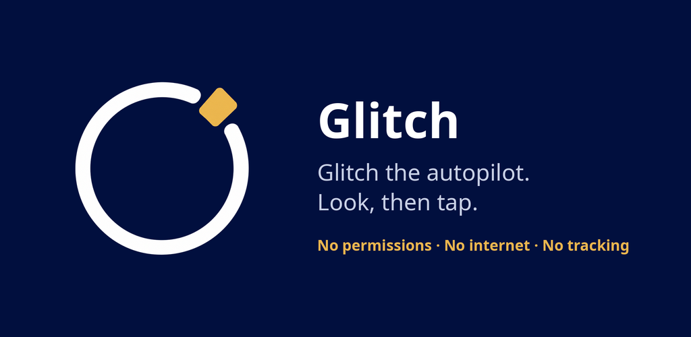

# Glitch

<p align="center">
  
</p>

**Glitch the autopilot. Look, then tap.**

[](https://github.com/benisalla/glitch/actions/workflows/ci.yml)


[](LICENSE)

Glitch is an Android app for breaking the autopilot on your phone. Its first feature is the shuffle: your installed apps in a new random order, so you look instead of tapping by position. Since v1.1 Glitch can also be your home screen, if you want: your apps reshuffle every time you unlock the phone, with up to 4 everyday apps kept in a fixed dock. Or keep your current home screen and open Glitch like any other app.

<p align="center">
  <a href="https://github.com/benisalla/glitch/releases/latest/download/glitch.apk"><b>⬇ Download Glitch for Android</b></a>
  &nbsp;·&nbsp; <a href="https://benisalla.github.io/glitch/">Website</a>
  &nbsp;·&nbsp; <a href="https://apps.obtainium.imranr.dev/redirect?r=obtainium://add/https://github.com/benisalla/glitch">Get updates with Obtainium</a>
</p>

## Vision
Your phone is designed to be tapped without thinking. Glitch is a small, kind interruption in that loop: today it shuffles your apps, right on your home screen if you like, so you look before you tap. Next, it grows into gentle cues you set yourself, designed using research on attention, habits and ADHD-friendly design. No lectures, no streaks, no lockouts, and nothing leaves your phone. Read the full [vision](VISION.md).

### Now and next
- **v1.1, Glitch as your home screen (current):** optionally set Glitch as your home app. Apps reshuffle on every unlock, and a fixed dock keeps up to 4 apps in place. Still no permissions.
- **v1.2, intention moment:** mark the apps that pull you in, get a calm "Still want this?" pause with your own if-then plans, and switch to focus sets. Still no permissions.
- **v1.3, gentle cues:** an optional kind time reminder, a focus widget and a Quick Settings tile.
- **v2.0, time awareness:** optional on-device usage awareness, and a first Scroll Glitch that steps in with *your own* reminder after long short-video sessions.
- **Future, the Scroll Glitch add-on:** detects endless Reels and Shorts scrolling and offers you a way out, as a separate opt-in companion app.

See the [roadmap](ROADMAP.md) and the research behind it in [`product/`](product/). Glitch is not a medical device and does not treat ADHD or any condition.

## What it does
- Shows every launchable app on the device (icon and name) in a shuffled order. Tap an app and it opens normally.
- **As a normal app:** shuffles once each time you open Glitch. The order stays the same while it is on screen, including when you rotate the phone. Coming back after opening an app gives a new order.
- **As your home screen (optional):** reshuffles each time you unlock the phone (after the screen has been off), and when the phone restarts. Going back to Home while you use the phone does not reshuffle, so the order stays steady until the next unlock.
- **Dock:** up to 4 apps stay in a fixed dock and are left out of the shuffle. The defaults are phone, messages, camera and browser. Long-press any app and choose "Add to dock" or "Remove from dock".
- Long-press an app and choose "App info" to open its Android settings page.
- If an app is installed or removed while Glitch is open, the list updates without reshuffling the other entries.

## What it does not do
- Being your home screen is **optional**. Glitch works as a normal app too, and you can switch back to your previous home screen at any time (see below).
- It does **not** change or rearrange Samsung's own launcher (One UI Home) or its app drawer. If you switch back, they are exactly as you left them.
- No reminders, blockers, timers, usage tracking or accounts.
- It is not a medical device and makes no claim to treat ADHD or improve focus, memory or intelligence. Today it only changes the order of the list.

## Permissions
None, also when Glitch is your home screen. The app does not request internet access or any other permission. To see which apps are installed it declares a narrow [`<queries>`](https://developer.android.com/training/package-visibility) entry for the standard launcher intent (`MAIN` / `LAUNCHER`), which lets it see only apps that appear in a launcher. It does not use `QUERY_ALL_PACKAGES`, and it has no analytics or network code.

## Build from source
Prerequisites:
- JDK 17
- Android SDK with platform 37 (`platforms;android-37.0`) and build-tools 36.0.0
- `ANDROID_HOME` set to the SDK path, or a `local.properties` file in the repo root containing `sdk.dir=/path/to/Android/Sdk`

Commands (run from the repo root):
```
./gradlew :app:assembleDebug              # builds app/build/outputs/apk/debug/app-debug.apk
./gradlew :app:testDebugUnitTest          # unit tests
./gradlew :app:lintDebug                  # lint
./gradlew :app:connectedDebugAndroidTest  # instrumented tests; needs a running emulator or connected device
```

## Install on a phone (including Samsung Galaxy)
The steps below are standard Android procedures; menu names can differ slightly between One UI versions.

**Easiest: download the APK**
1. On your phone, open [glitch.apk](https://github.com/benisalla/glitch/releases/latest/download/glitch.apk) (always the latest release) or scan the QR code on the [website](https://benisalla.github.io/glitch/#install).
2. Open the downloaded file. When Android asks, allow "Install unknown apps" for your browser or My Files, then tap Install.
3. Android or Play Protect may warn you because Glitch is not on the Play Store yet. Glitch has no permissions and no internet access, and its source code is right here.

For automatic updates, add `https://github.com/benisalla/glitch` in [Obtainium](https://obtainium.imranr.dev/).

**Option A: with adb (from a computer)**
1. On the phone, open Settings > About phone > Software information and tap "Build number" seven times to enable Developer options.
2. Open Settings > Developer options and turn on "USB debugging".
3. Connect the phone by USB and accept the "Allow USB debugging?" prompt.
4. Build the APK (above), then run:
   ```
   adb install -r app/build/outputs/apk/debug/app-debug.apk
   ```

**Option B: download the APK built by CI**
1. On GitHub, open the repository's Actions tab, pick a successful workflow run, and download the artifact named `glitch-debug-apk`.
2. Unzip it to get `app-debug.apk` and copy the APK to the phone (or download it on the phone directly).
3. Open the APK with My Files or your browser. When asked, allow "Install unknown apps" for that app, then tap Install.

**Keep it as an app**
Open the app drawer, long-press "Glitch", and choose "Add to Home". Open Glitch from that icon whenever you want a shuffled list.

**Make Glitch your home screen (optional)**
- In Glitch, tap the card "Make Glitch your home screen" and pick Glitch in Android's chooser.
- Or, on Samsung: Settings → Apps → Choose default apps → Home app → Glitch.
- On other Android phones: Settings → Apps → Default apps → Home app → Glitch (the exact names vary by phone).

**Switch back**
- In Glitch, choose "Change home app" and pick your previous home screen (on Samsung, "One UI Home").
- Or, on Samsung: Settings → Apps → Choose default apps → Home app → One UI Home. Your old home screen and app drawer come back exactly as they were.
- If you uninstall Glitch, Android switches to another installed home app on its own.

## Known limitations
- As a home screen, this version has no widgets, no wallpaper support and no app search.
- It never changes the One UI launcher or app drawer; switching back restores them as they were.
- Apps in a work profile or Samsung Secure Folder are not listed.
- Release builds are signed only when you provide your own upload key in `keystore.properties` (see `store/README.md`); without it `bundleRelease` produces an unsigned bundle.
- Tested on an Android emulator (API 35) only; not yet tested on a physical Samsung device.
- The built manifest contains one entry added automatically by AndroidX Core: `com.benisalla.glitch.DYNAMIC_RECEIVER_NOT_EXPORTED_PERMISSION`. It is signature-level and private to this app, is never shown to the user, and grants no access to anything. The app requests no user-facing permissions.
- Lint reports 2 warnings and no errors: `OldTargetApi` (targetSdk is 36 while compileSdk is 37) and `DataExtractionRules` (backup is disabled with `allowBackup="false"`; the app stores no user data).

## Release / Play Store
Listing text, icon and feature graphic, Data safety answers and a step-by-step release checklist are in [`store/`](store/README.md). The privacy policy is [`docs/privacy-policy.md`](docs/privacy-policy.md), which must be hosted at a public URL (see step 5 of the checklist). The launcher icon and store graphics are generated by `python3 store/tools/make_graphics.py`.

## Contributing
See [CONTRIBUTING.md](CONTRIBUTING.md). Agent and contributor rules are in [AGENTS.md](AGENTS.md).

## License
Released under the [MIT License](LICENSE).
